# BÁO CÁO THỰC HÀNH LẬP TRÌNH C# WINFORMS (3-TIER ARCHITECTURE)

## MỤC 1: THÔNG TIN SINH VIÊN

- **Họ và tên sinh viên:** Lê Minh Dũng
- **Mã sinh viên:** 24810320213
- **Lớp / Khóa:** D19QTANM1 - Môn: Lập trình .NET
- **Tên Đề tài / Bài tập:** Báo cáo thực hành Bài 6.3, Bài 6.4, Bài 6.5

## CẤU TRÚC THƯ MỤC DỰ ÁN (Chuẩn 3-Tier Architecture)

```
BT.NET_10-11-2026/
├── Database/
│   ├── ScriptDB_ProjectTask.sql
│   ├── ScriptDB_Garage.sql
│   └── ScriptDB_Karaoke.sql
├── Image/
├── src/
│   ├── BT6.3/
│   │   ├── BT6.3.slnx  BT6.3.csproj
│   │   ├── DTO/  DAL/  BUS/
│   │   ├── GUI/  (frmMain, frmDuAn, frmCongViec, frmBaoCao)
│   │   └── App.config / Program.cs
│   ├── BT6.4/
│   │   ├── BT6.4.slnx  BT6.4.csproj
│   │   ├── DTO/  DAL/  BUS/
│   │   ├── GUI/  (frmMain, frmTiepNhan, frmPhuTung, frmPhieuSuaChua, frmThanhToan)
│   │   └── App.config / Program.cs
│   └── BT6.5/
│       ├── BT6.5.slnx  BT6.5.csproj
│       ├── DTO/  DAL/  BUS/
│       ├── GUI/  (frmMain, frmDichVu)
│       └── App.config / Program.cs
├── .gitignore
└── README.md
```

## HƯỚNG DẪN CÀI ĐẶT & CHẠY DỰ ÁN

1. **Khởi tạo CSDL (SSMS):** mở và thực thi (F5) các file trong `Database/`:
   - `ScriptDB_ProjectTask.sql` → tạo CSDL `ProjectTaskDB` (Bài 6.3).
   - `ScriptDB_Garage.sql` → tạo CSDL `GarageDB` (Bài 6.4).
   - `ScriptDB_Karaoke.sql` → tạo CSDL `KaraokeDB` (Bài 6.5).
2. **Mở dự án:** mở file `src/BT6.x/BT6.x.slnx` bằng **Visual Studio** (.NET Framework 4.8).
3. **Chuỗi kết nối:** sửa `Data Source` trong `DAL/DatabaseHelper.cs` nếu SQL Server không phải `.\SQLEXPRESS`:
   ```csharp
   @"Data Source=.\SQLEXPRESS;Initial Catalog=[Tên_CSDL];Integrated Security=True;TrustServerCertificate=True"
   ```
4. **Chạy:** nhấn **F5** (Visual Studio tự tải lại NuGet `Microsoft.Data.SqlClient`).

---

## MỤC 2: HÌNH ẢNH KẾT QUẢ CÁC MÀN HÌNH CHỨC NĂNG

### BÀI 6.3 - QUẢN LÝ CÔNG VIỆC & TIẾN ĐỘ DỰ ÁN (PROJECT & TASK MANAGEMENT)

- Thêm, sửa, xóa dự án; tạo công việc con thuộc dự án và giao việc cho một hoặc nhiều thành viên (`CheckedListBox`) qua DTO/BUS/DAL.
- Giao diện **Kanban** (4 cột To Do / In Progress / Review / Done) và **List view** (`DataGridView`); lọc task theo dự án và trạng thái.
- Chuyển trạng thái task bằng nút "Lùi / Tiến trạng thái" → cập nhật CSDL bằng **Parameterized SQL UPDATE**.
- Cảnh báo trễ hạn: `SqlDataReader` lấy các task quá `HanNop` mà `TrangThai != 'Done'`; thống kê % hoàn thành của từng thành viên bằng `GROUP BY`, tiến độ dự án bằng `ExecuteScalar`.

1. **Màn hình Chính / Tổng quan hệ thống (Kanban):** 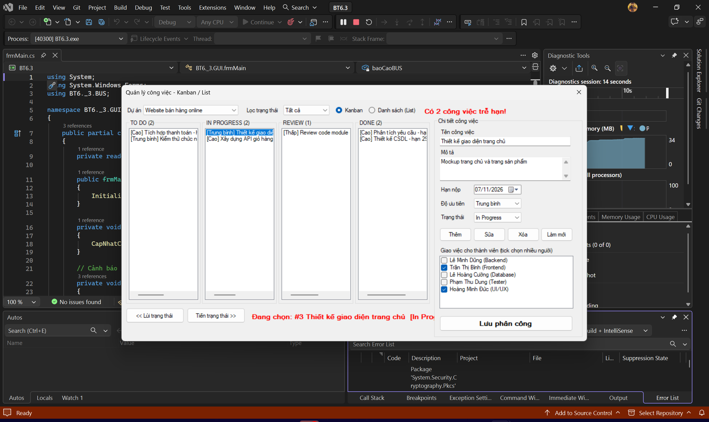
2. **Màn hình Quản lý Danh mục (CRUD - Thêm/Sửa/Xóa dự án):** 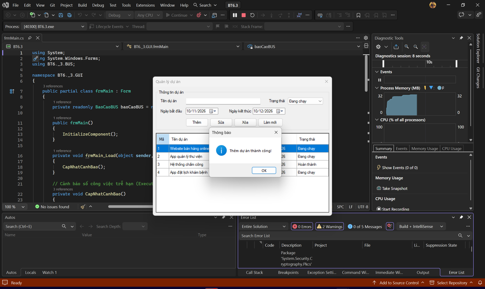
3. **Màn hình Thực thi Nghiệp vụ chính (Chuyển trạng thái task - List view):** 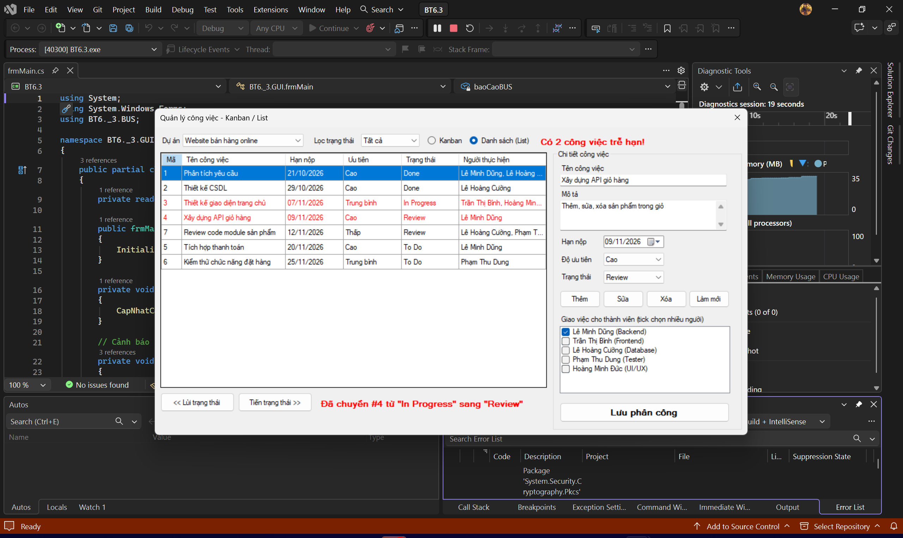
4. **Màn hình Báo cáo - Thống kê (Trễ hạn & % hoàn thành):** 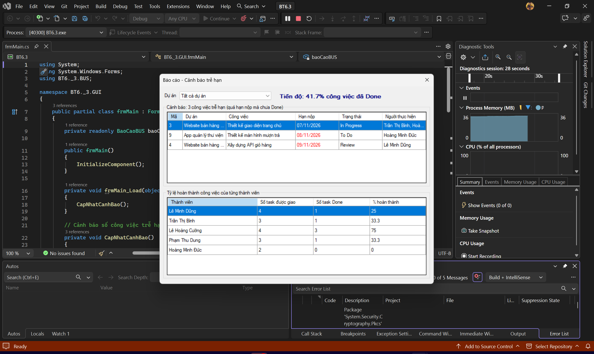
5. **Minh họa An toàn Dữ liệu (Kiểm tra dữ liệu nhập bằng ErrorProvider):** 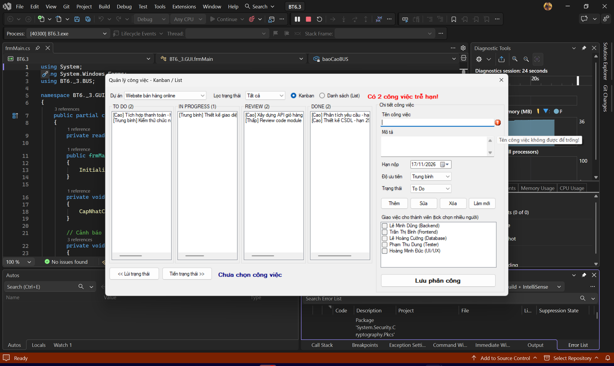

### BÀI 6.4 - QUẢN LÝ GARAGE VÀ BẢO DƯỠNG XE Ô TÔ (GARAGE MANAGEMENT SYSTEM)

- Tiếp nhận xe: tra cứu biển số bằng `SqlParameter`; xe mới thì nhập thông tin chủ xe và xe (thêm trong 1 transaction). Quản lý danh mục phụ tùng, cập nhật đơn giá và số lượng tồn.
- **Lập phiếu sửa chữa (SqlTransaction):** tạo `PhieuSuaChua` → tạo `ChiTietSuaChua` → trừ `SoLuongTon` của phụ tùng; phụ tùng không đủ thì `trans.Rollback()` và báo lỗi.
- **Thanh toán & xuất hóa đơn:** Tổng chi phí = Tổng (Số lượng × Đơn giá) + Tổng tiền công, chuyển phiếu sang "Đã thanh toán"; lưu hóa đơn ra file `.txt` bằng `SaveFileDialog`.

1. **Màn hình Chính / Tổng quan hệ thống:** 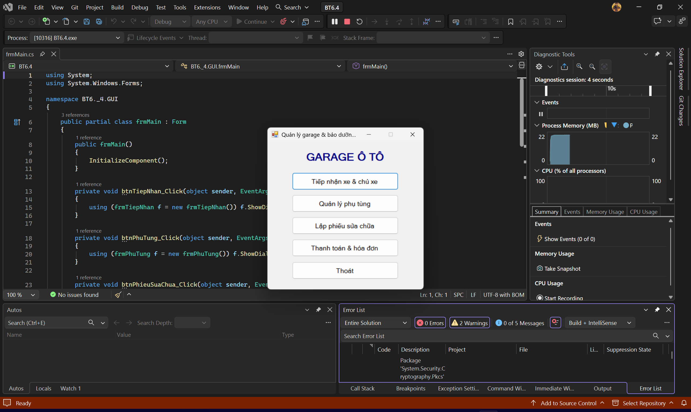
2. **Màn hình Quản lý Danh mục (Tiếp nhận xe & chủ xe mới):** 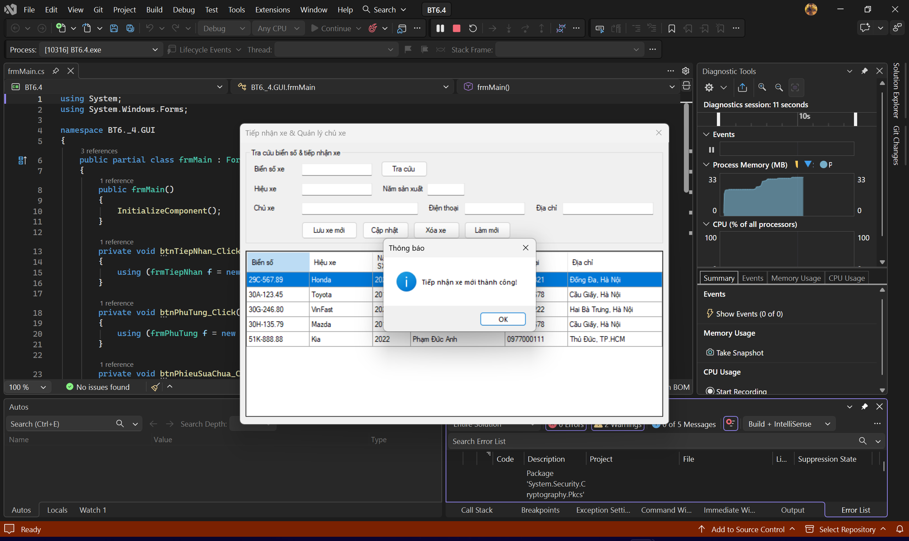
3. **Màn hình Thực thi Nghiệp vụ chính (Lập phiếu sửa chữa):** 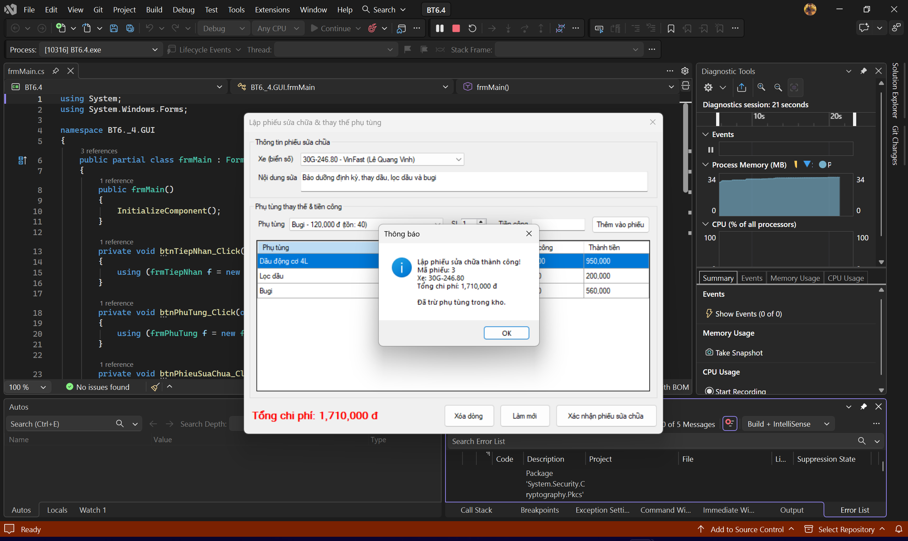
4. **Màn hình Báo cáo - Thống kê (Thanh toán & hóa đơn):** 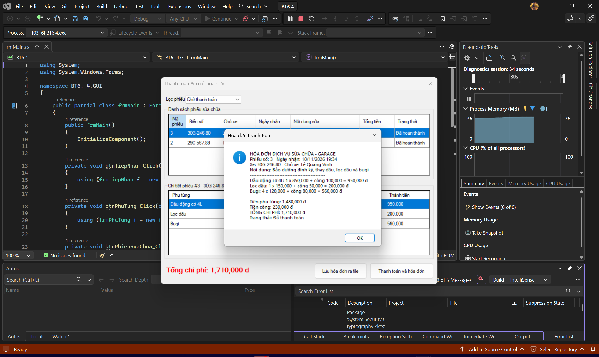
5. **Minh họa An toàn Dữ liệu (Rollback khi thiếu phụ tùng):** 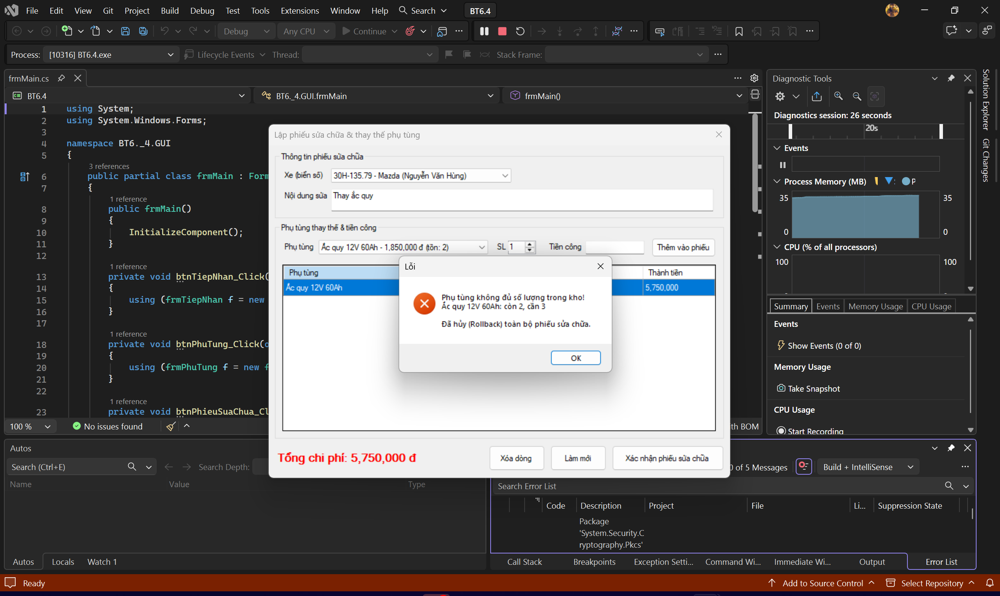

### BÀI 6.5 - QUẢN LÝ ĐẶT PHÒNG & DỊCH VỤ KARAOKE (KARAOKE MANAGEMENT SYSTEM)

- **Sơ đồ phòng hát:** danh sách nút tạo động trong `FlowLayoutPanel`, phòng "Trống" màu xanh, "Đang hát" màu đỏ. Chọn phòng trống → "Mở phòng" tạo `HoaDon` với `GioVao = GETDATE()`, phòng chuyển "Đang hát".
- Tính giờ tự động bằng `Timer` (thời gian hát và tiền tạm tính cập nhật mỗi giây).
- **Gọi dịch vụ (Disconnected Model):** dịch vụ đã gọi nạp vào `DataTable` bằng `SqlDataAdapter`, hiển thị trên `DataGridView`; gọi thêm thì sửa `DataTable` rồi đồng bộ bằng `SqlCommandBuilder` + `adapter.Update()`.
- **Thanh toán (SqlTransaction):** thời gian hát = GioRa − GioVao, `TongTienPhong = Số giờ × GiaTheoGio` → cập nhật `HoaDon` (GioRa, TongTienPhong, TongTienDichVu, TrangThai = 1) → trừ `TonKho` → phòng về "Trống" → `Commit`; kho không đủ thì `Rollback`.

1. **Màn hình Chính / Tổng quan hệ thống (Sơ đồ phòng):** 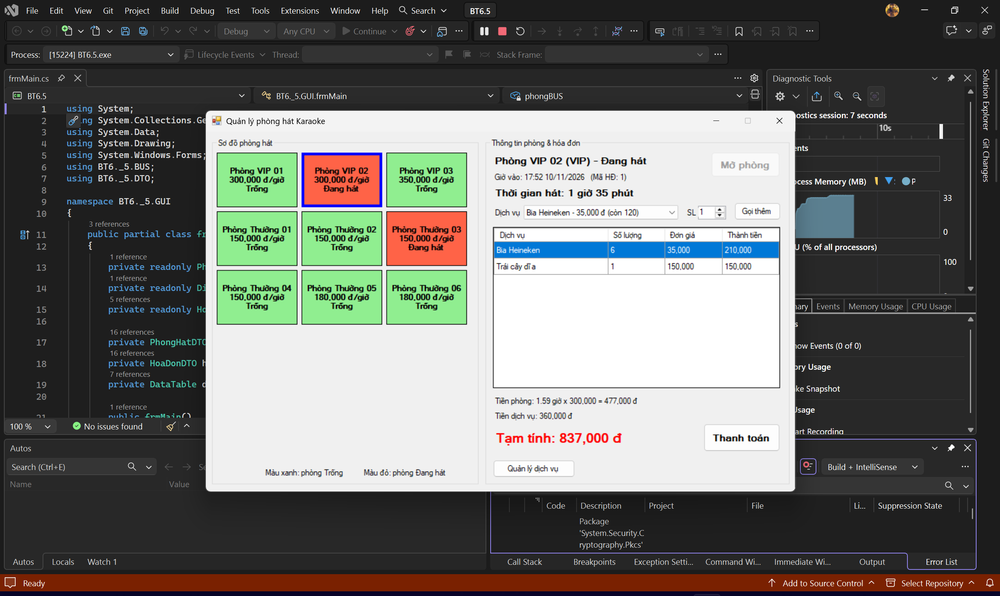
2. **Màn hình Quản lý Danh mục (CRUD dịch vụ / đồ uống):** 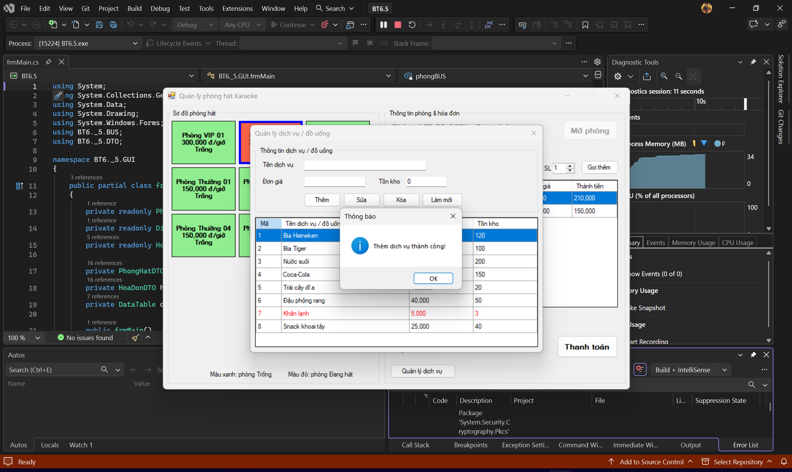
3. **Màn hình Thực thi Nghiệp vụ chính (Mở phòng & gọi dịch vụ):** 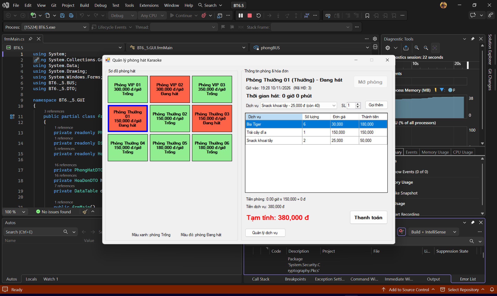
4. **Màn hình Báo cáo - Thống kê (Hóa đơn thanh toán):** 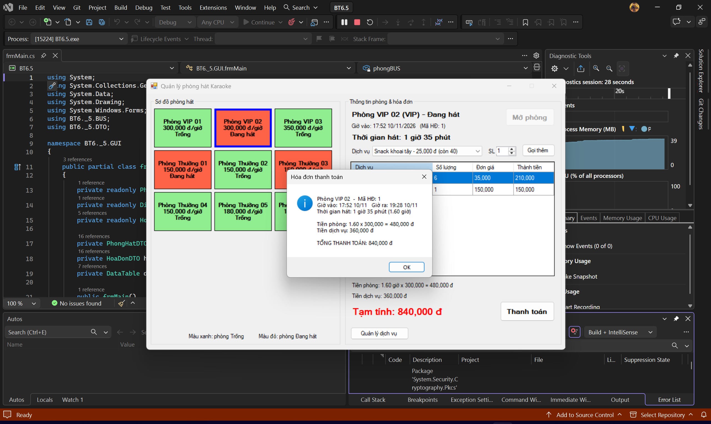
5. **Minh họa An toàn Dữ liệu (Rollback khi không đủ hàng trong kho):** 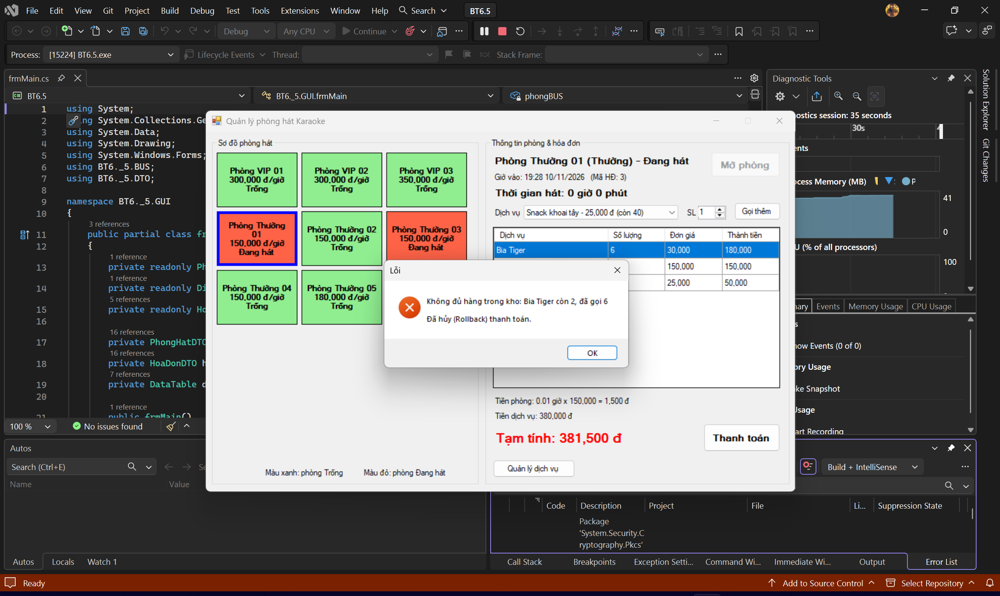

---

## MỤC 3: KẾT LUẬN

- Cả 3 bài tách rõ 4 lớp: GUI - BUS - DAL - DTO; giao diện dùng các control kéo từ Toolbox (`ErrorProvider`, `BindingSource`, `Timer`, `SaveFileDialog`, `CheckedListBox`...).
- Các nghiệp vụ quan trọng (giao việc, lập phiếu sửa chữa, mở phòng, thanh toán) đều dùng `SqlTransaction` để dữ liệu luôn toàn vẹn.
- Mọi truy vấn dùng `SqlParameter`, chống SQL Injection.
